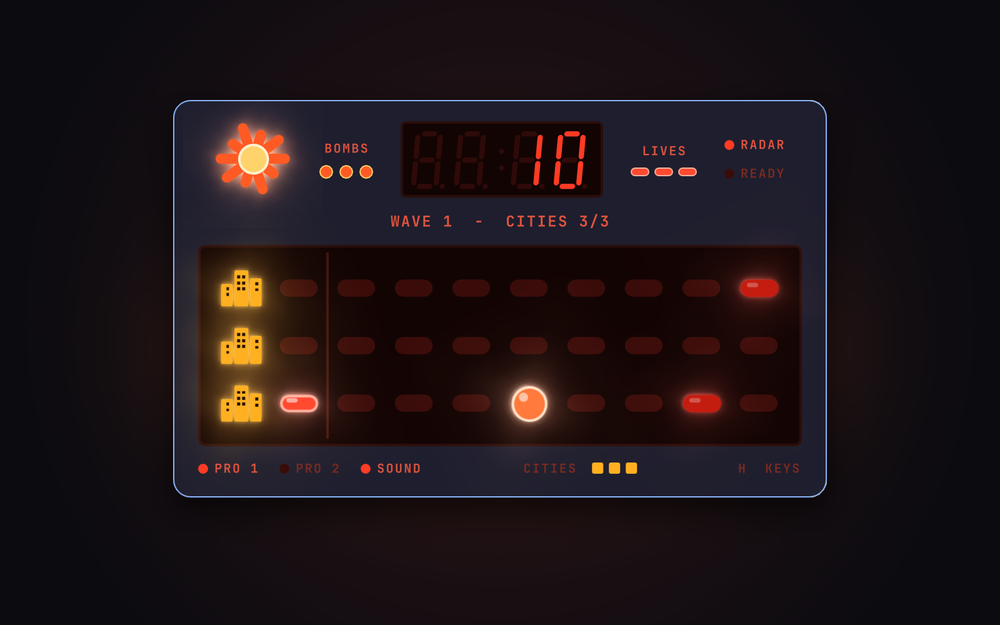

# Night Raid

A retro handheld LED defense game for [Omarchy](https://omarchy.org/), from the same shelf as
[LED Gridiron](https://github.com/jameydavis/led-gridiron) and [LED Hoops](https://github.com/jameydavis/led-hoops).
Three amber city lights, a launcher, and wave after wave of red raiders, with a 7-segment
scoreboard and an air-raid siren, all running inside the Omarchy shell.



Raiders fly in from the right. Any one that reaches the left edge blacks out that lane's city, and
when all three cities are dark the lights are out for good. Slide your launcher between lanes and
fire down them, but only two shells can be in the air at a time.

## Install

```bash
omarchy plugin add https://github.com/jameydavis/night-raid.git --enable
```

Click the jet icon in the bar to play. To open it from a key, add a binding in
`~/.config/hypr/bindings.lua` that runs:

```bash
omarchy-shell jameydavis.night-raid toggle
```

## Keys

| Key | Button |
| --- | --- |
| `W` / `S` (or `↑` / `↓`) | Slide the launcher up or down a lane. The first move starts the wave |
| `Space` | **Fire** a shell down the launcher's lane |
| `B` | **Mega bomb**: destroys every raider on screen at once. Three per game, and they don't refill between waves |
| `Q` | **Status**: between waves, starts the next one. Otherwise shows the wave and cities left; hold to keep them up |
| `R` | **High score**: tap for a quick look, hold to keep it up |
| `1` / `2` | **Pro 1** (slower raiders) / **Pro 2** (fast raiders from the start), switchable between waves |
| `P` | Pause |
| `M` | Sound on/off |
| `N` `N` | New game (press twice). Your high score carries over |
| `H` | Show or hide the key legend under the display |
| `Esc` | Close (a wave in progress is paused) |

## Rules

- Each wave sends more raiders, faster, with shorter gaps between them.
- Raiders sometimes veer diagonally into a neighboring lane, and later waves do it more often.
- The starburst LED next to the scoreboard flashes every time a shell hits a raider.
- Swamped? A mega bomb clears the whole sky and still scores every raider it takes out. The BOMBS
  lights next to the starburst show how many you have left for the whole game.
- From wave 2, bright **armored** raiders take two hits. From wave 3, **fast** raiders flicker and
  fly two columns at a time.
- A raider that rams your launcher is destroyed, but the launcher is knocked out for a moment and
  its shells in flight are lost.
- Raiders are worth 10 points, fast ones 20 and armored ones 30, all multiplied by the wave number.
  Each city still lit after a wave earns a 50 × wave bonus.
- Lost cities stay dark for the rest of the game.

## Requirements

- Omarchy with the Quickshell-based `omarchy-shell`
- Qt's `QtQuick.Effects` (MultiEffect) for the LED glow, part of Qt 6 and already used by the
  Omarchy shell
- `pw-play` / `pw-cat` (PipeWire, standard on Omarchy) for sound. While the game is open, it holds a
  silent stream so the audio output doesn't fall asleep between plays and swallow beeps.

No network access, no files written, and no changes to your configuration beyond what
`omarchy plugin add` / `enable` themselves do. The high score lasts until the shell restarts.

## Development

```bash
node test/logic.test.js        # rules engine tests, including fuzzed full games
python3 tools/gen_sounds.py    # rebuild sounds/*.wav from the synth recipes
omarchy plugin validate .
```

`Logic.js` holds the rules (plain JS, no QML). `BarWidget.qml` runs the timers, input, sound and the
device face. `Sky.qml` draws the LED display, and `SevenSeg.qml` draws the scoreboard digits.

## Uninstall

```bash
omarchy plugin remove jameydavis.night-raid
```

## License

MIT. An original game inspired by the handheld LED games of the late 1970s. It is not affiliated
with or endorsed by any toy or game company.
